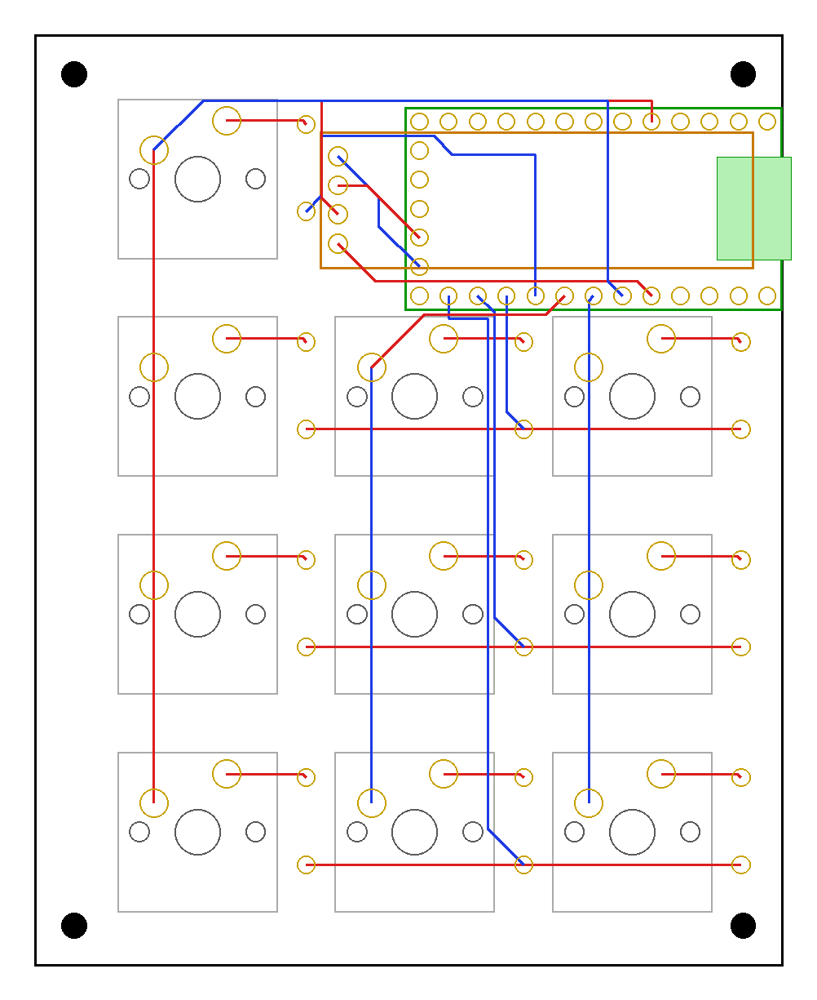

# choyapad

A 3x3 + 1 macropad with a 128x32 OLED, built around an RP2040 Pro Micro. Through-hole parts only, so it's easy to hand-solder.

## What's here

| Folder | Contents |
|---|---|
| `pcb/` | KiCad 10 project (schematic + PCB) |
| `gerbers/`, `gerbers.zip` | Fabrication files, ready to upload to JLCPCB or similar (2-layer) |
| `case/` | 3D-printable case: cover plate + tray (STL / 3MF) and the Python scripts that generate them |
| `firmware/choyapad/` | QMK keyboard definition and default keymap |

## Bill of materials

| Qty | Ref | Part | Notes |
|---|---|---|---|
| 10 | S1-S10 | MX-style switches | Soldered (no hot-swap sockets) |
| 10 | D1-D9, D11 | 1N4148 diode, DO-35 through-hole | On the back of the board (there is no D10) |
| 1 | U1 | RP2040 Pro Micro | On the back, USB-C out of the right edge; plus pin headers |
| 1 | J1 | 0.91" 128x32 I2C OLED (SSD1306) | 4-pin GND / VCC / SCL / SDA; plus a 4-pin header |
| 10 | - | 1U MX keycaps | |
| 4 | - | M2 screws | For the 4 mounting holes |

## Firmware

Copy `firmware/choyapad` into `qmk_firmware/keyboards/`, then:

    qmk compile -kb choyapad -km default

Pins: columns GP2, GP4, GP3; rows GP5-GP8 (COL2ROW); OLED on I2C0 (SDA GP12, SCL GP13).

The default keymap includes some Guild Wars 2 chat macros and a Windows launcher macro
(`C:\path\to\launch_games.bat`). Edit `keymaps/default/keymap.c` to suit yourself.

To flash: hold BOOT on the Pro Micro while plugging it in (or double-tap RST, or hold the top-left key),
then copy the `.uf2` onto the drive that appears.

## Case

- `3x3_+1_OLED_2026.9.26c_cover-plate_no-pin-hole.stl` / `.3mf`: top plate with the OLED window. The OLED header pins
  must be trimmed to sit no more than 6.2 mm above the bottom of the main PCB.
- `choyapad-tray-TILT10-2color.3mf`: tray tilted 10 degrees, with "choyapad" text on the bottom as a second colour
  (Bambu Studio project for an A1, two manual filament swaps).
- `3x3_+1_OLED_2026.9.26c_tray-choya.stl`: the same tilted tray as a single-colour STL.

The `build_*.py` scripts regenerate the models (`pip install manifold3d shapely numpy pillow`).
Set the font path in `choya_art.py` (`/path/to/DejaVuSans-Bold.ttf`) to a DejaVu Sans Bold on your system first.
